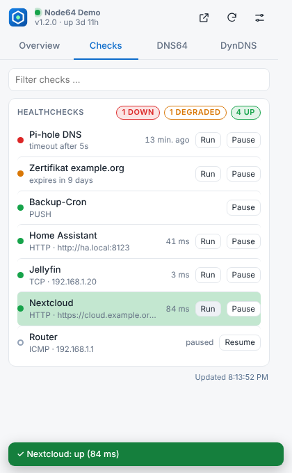

# Node64 Browser Extension

Inoffizielles Browser-Addon für [Node64](https://github.com/ipv64net/node64) und [ipv64.net](https://ipv64.net) – für Chrome/Chromium und Firefox aus einer Codebasis (Manifest V3, reines JavaScript, kein Build-Schritt).

> Kein offizielles Projekt von IPv64.net. Node64 und IPv64.net sind Namen ihrer jeweiligen Inhaber.



## Funktionen

- **Übersicht** – Node-Name, Version, Laufzeit, Zustand aller Module, Zertifikate mit Handlungsbedarf, Verknüpfung mit ipv64.net, Kontingente des ipv64.net-Kontos.
- **Healthchecks** – alle Checks mit Zustand und Latenz, Filter, „Jetzt prüfen“, Pausieren/Fortsetzen. Gestörte Checks stehen als Zahl am Symbol, Ausfälle kommen als Browser-Benachrichtigung.
- **DNS64** – Filter-Status, Kennzahlen der letzten 24 Stunden, Blockieren für 5/30/60 Minuten oder unbegrenzt pausieren, Cache leeren. Für die gerade offene Seite: Domain freigeben oder sperren. Dazu die zuletzt blockierten Domains mit Freigabe per Klick.
- **DynDNS** – öffentliche IPv4/IPv6 mit Kopieren, Hinweis auf CGNAT/DS-Lite, Ziele mit Zustand und „Aktualisieren“, Domains aus dem ipv64.net-Konto.
- **Kontextmenü** – Rechtsklick auf Seite oder Link: Domain in DNS64 freigeben bzw. sperren.
- Deutsch und Englisch, helles und dunkles Design.

## Installation

### Chrome, Edge, Brave

1. `chrome://extensions` öffnen und den **Entwicklermodus** einschalten.
2. **Entpackte Erweiterung laden** und diesen Ordner wählen.

### Firefox (ab 128)

**[➜ Node64 Browser Extension bei Firefox Add-ons](https://addons.mozilla.org/de/firefox/addon/node64-browser-extension/)** – dort auf **Zu Firefox hinzufügen** klicken. Updates kommen automatisch.

Aus dem Quellcode (für Entwicklung): Firefox braucht ein leicht anderes Manifest, deshalb zuerst `python3 scripts/build.py` ausführen, dann `about:debugging#/runtime/this-firefox` → **Temporäres Add-on laden** → `dist/firefox/manifest.json` wählen (gilt bis zum Neustart).

Was sich in welcher Version geändert hat, steht im [Changelog](CHANGELOG.md).

## Einrichtung

1. In Node64 unter **Einstellungen** einen API-Key anlegen (beginnt mit `node64_`, wird nur einmal angezeigt).
2. In den Einstellungen des Addons Adresse (z. B. `http://raspberrypi.local:8080`) und Key eintragen, **Verbindung testen**, **Speichern**. Der Browser fragt dabei einmalig nach dem Zugriff auf genau diese Adresse.
3. Optional einen API-Key von ipv64.net eintragen – dann zeigt das Addon Konto und Domains auch, wenn die Node nicht erreichbar ist.

Die Adresse darf `http://` oder `https://` sein. Läuft Node64 per HTTPS mit einem selbst signierten Zertifikat, muss der Browser diesem Zertifikat vertrauen, sonst schlägt die Abfrage fehl.

## Technik

| Datei | Aufgabe |
| --- | --- |
| `manifest.json` | Manifest für Chrome (Service Worker) |
| `manifest.firefox.json` | Abweichungen für Firefox (Hintergrundseite, Add-on-ID); `scripts/build.py` legt sie darüber |
| `lib/api.js` | Clients für die Node64-API (`/api`, Bearer-Key) und die ipv64.net-API v2 |
| `background.js` | Polling per Alarm, Badge, Benachrichtigungen, Kontextmenü |
| `popup.*` | Oberfläche mit vier Reitern |
| `options.*` | Einstellungen |
| `_locales/` | Texte in Deutsch und Englisch |

Die Endpunkte stammen aus der OpenAPI-Beschreibung von Node64 (`/api/openapi.json`, Referenz unter `/api/docs` auf der eigenen Node).

### Berechtigungen

- `storage` – Einstellungen und Keys, nur lokal in diesem Browser.
- `alarms`, `notifications` – regelmäßige Abfrage und Meldungen bei Ausfällen.
- `activeTab` – Domain der offenen Seite lesen, wenn das Popup geöffnet wird.
- `contextMenus` – die beiden Einträge im Rechtsklick-Menü.
- Host-Zugriff: fest nur `https://ipv64.net/*`; die Adresse der eigenen Node wird beim Speichern einzeln angefragt.

Das Addon sendet Daten ausschließlich an die eingetragene Node64 und an ipv64.net. Anfragen gehen ohne Cookies raus (`credentials: 'omit'`), die Sitzung des Web-UI wird nie mitbenutzt.

## Entwicklung

```sh
python3 scripts/build.py                     # dist/chrome, dist/firefox und je ein ZIP
npx web-ext lint --source-dir dist/firefox   # Prüfung für Firefox
npx web-ext run --source-dir dist/firefox    # Firefox mit geladenem Addon starten
```

## Lizenz

MIT
