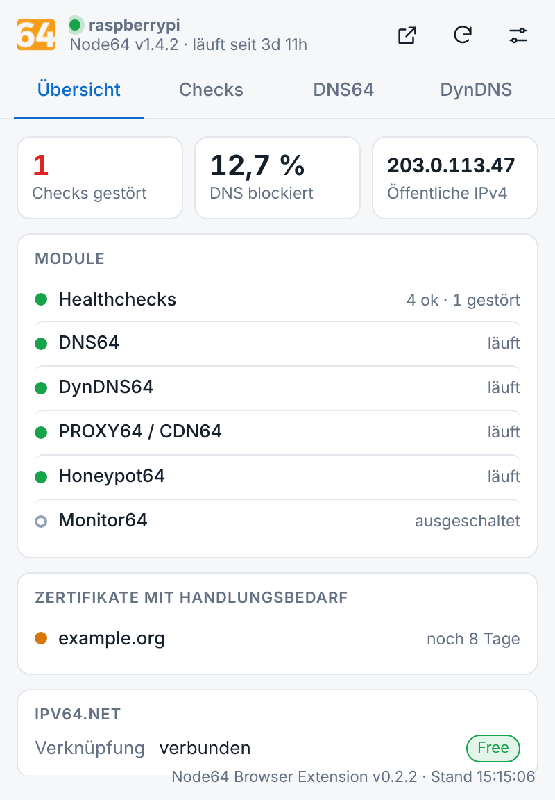
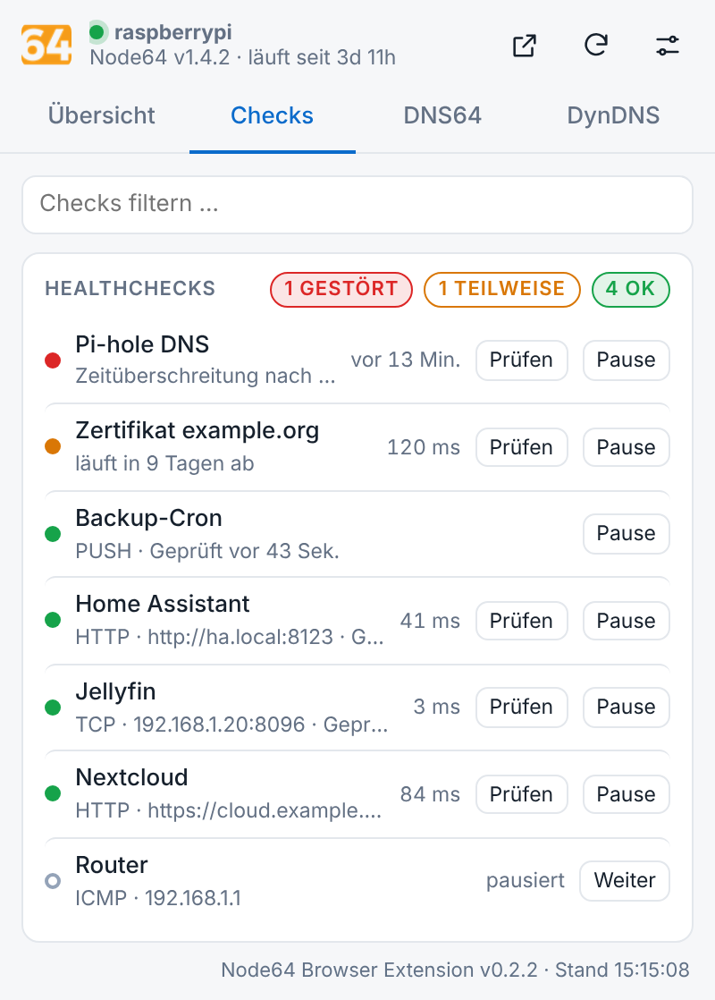
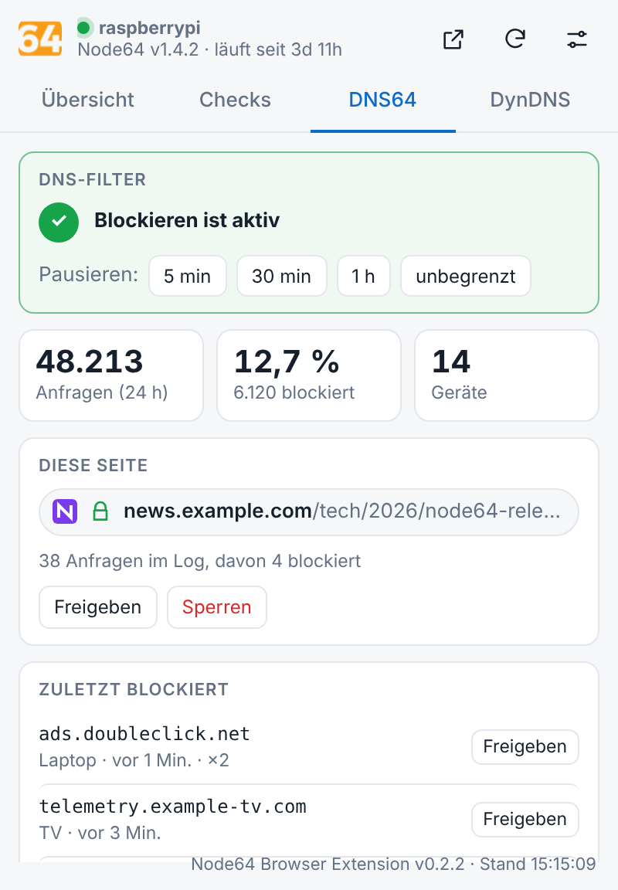
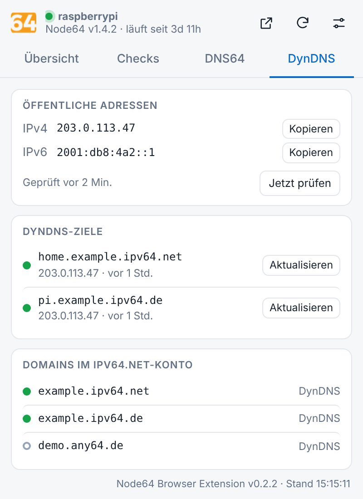

# Node64 Browser Extension

Inoffizielles Browser-Addon für [Node64](https://github.com/ipv64net/node64) und [ipv64.net](https://ipv64.net) – für Chrome/Chromium und Firefox aus einer Codebasis (Manifest V3, reines JavaScript, kein Build-Schritt).

> Kein offizielles Projekt von IPv64.net. Node64 und IPv64.net sind Namen ihrer jeweiligen Inhaber.

<p>
  
  
  
  
</p>

<sub>Screenshots mit Testdaten. Weitere Bilder, auch die für die Stores, liegen in [`docs/store`](docs/store).</sub>

## Funktionen

- **Übersicht** – Node-Name, Version, Laufzeit, Zustand aller Module, Zertifikate mit Handlungsbedarf, Verknüpfung mit ipv64.net, Kontingente des ipv64.net-Kontos.
- **Healthchecks** – alle Checks mit Zustand und Latenz, Filter, „Jetzt prüfen“, Pausieren/Fortsetzen. Gestörte Checks stehen als Zahl am Symbol, Ausfälle kommen als Browser-Benachrichtigung.
- **DNS64** – Filter-Status, Kennzahlen der letzten 24 Stunden, Blockieren für 5/30/60 Minuten oder unbegrenzt pausieren, Cache leeren. Für die gerade offene Seite: Domain freigeben oder sperren. Dazu die zuletzt blockierten Domains mit Freigabe per Klick.
- **DynDNS** – öffentliche IPv4/IPv6 mit Kopieren, Hinweis auf CGNAT/DS-Lite, Ziele mit Zustand und „Aktualisieren“, Domains aus dem ipv64.net-Konto.
- **Kontextmenü** – Rechtsklick auf Seite oder Link: Domain in DNS64 freigeben bzw. sperren.
- Deutsch und Englisch, helles und dunkles Design.

## Installation

Fertige Pakete für jede Version gibt es unter **[Releases](https://github.com/sakis-tech/node64-browser-extension/releases/latest)**: je eine ZIP für Chrome und für Firefox. Was sich geändert hat, steht im [Changelog](CHANGELOG.md).

### Firefox (ab 128)

**Empfohlen:** **[➜ Node64 Browser Extension bei Firefox Add-ons](https://addons.mozilla.org/de/firefox/addon/node64-browser-extension/)** – dort auf **Zu Firefox hinzufügen** klicken. Updates kommen automatisch.

Aus der ZIP (zum Testen): Firefox installiert dauerhaft nur von Mozilla signierte Addons. Die ZIP aus den Releases lässt sich deshalb nur bis zum nächsten Neustart laden:

1. `node64-browser-extension-<Version>-firefox.zip` herunterladen (nicht entpacken).
2. `about:debugging#/runtime/this-firefox` öffnen.
3. **Temporäres Add-on laden …** klicken und die ZIP auswählen.

### Chrome, Edge, Brave und andere Chromium-Browser

Der Eintrag im Chrome Web Store ist eingereicht. Bis er freigeschaltet ist, so installieren:

1. `node64-browser-extension-<Version>-chrome.zip` herunterladen und **entpacken**, am besten in einen Ordner, der dauerhaft bleibt (z. B. unter Dokumente). Der Browser lädt das Addon bei jedem Start aus diesem Ordner.
2. `chrome://extensions` öffnen (Edge: `edge://extensions`, Brave: `brave://extensions`) und den **Entwicklermodus** einschalten.
3. **Entpackte Erweiterung laden** und den entpackten Ordner wählen (der Ordner, in dem `manifest.json` liegt).

Update auf eine neue Version: neue ZIP in denselben Ordner entpacken (alte Dateien ersetzen) und auf der Erweiterungsseite beim Addon auf **Neu laden** klicken. Die Einstellungen bleiben erhalten.

## Einrichtung

1. In Node64 unter **Einstellungen** einen API-Key anlegen (beginnt mit `node64_`, wird nur einmal angezeigt).
2. In den Einstellungen des Addons Adresse (z. B. `http://raspberrypi.local:8080`) und Key eintragen, **Verbindung testen**, **Speichern**. Der Browser fragt dabei einmalig nach dem Zugriff auf genau diese Adresse.
3. Optional einen API-Key von ipv64.net eintragen – dann zeigt das Addon Konto und Domains auch, wenn die Node nicht erreichbar ist.

Die Adresse darf `http://` oder `https://` sein. Läuft Node64 per HTTPS mit einem selbst signierten Zertifikat, muss der Browser diesem Zertifikat vertrauen, sonst schlägt die Abfrage fehl.

## Technik

```
src/              Quellcode des Addons (wird so in die ZIPs gepackt)
scripts/          build.py (Pakete bauen), screenshots/ (Screenshots mit Testdaten)
docs/             Bilder für README und Stores
```

| Datei in `src/` | Aufgabe |
| --- | --- |
| `manifest.json` | Manifest für Chrome (Service Worker) |
| `manifest.firefox.json` | Abweichungen für Firefox (Hintergrundseite, Add-on-ID); `scripts/build.py` legt sie darüber |
| `lib/api.js` | Clients für die Node64-API (`/api`, Bearer-Key) und die ipv64.net-API v2 |
| `background.js` | Polling per Alarm, Badge, Benachrichtigungen, Kontextmenü |
| `popup.*` | Oberfläche mit vier Reitern |
| `options.*` | Einstellungen |
| `_locales/` | Texte in Deutsch und Englisch |

Die Endpunkte stammen aus der OpenAPI-Beschreibung von Node64 (`/api/openapi.json`, Referenz unter `/api/docs` auf der eigenen Node).

### Berechtigungen

- `storage` – Einstellungen und Keys, nur lokal in diesem Browser.
- `alarms`, `notifications` – regelmäßige Abfrage und Meldungen bei Ausfällen.
- `activeTab` – Domain der offenen Seite lesen, wenn das Popup geöffnet wird.
- `contextMenus` – die beiden Einträge im Rechtsklick-Menü.
- Host-Zugriff: fest nur `https://ipv64.net/*`; die Adresse der eigenen Node wird beim Speichern einzeln angefragt.

Das Addon sendet Daten ausschließlich an die eingetragene Node64 und an ipv64.net. Anfragen gehen ohne Cookies raus (`credentials: 'omit'`), die Sitzung des Web-UI wird nie mitbenutzt. Details in der [Datenschutzerklärung](PRIVACY.md).

## Entwicklung

```sh
python3 scripts/build.py                     # dist/chrome, dist/firefox und je ein ZIP
python3 scripts/screenshots/make.py          # Screenshots neu erzeugen (braucht Playwright)
npx web-ext lint --source-dir dist/firefox   # Prüfung für Firefox
npx web-ext run --source-dir dist/firefox    # Firefox mit geladenem Addon starten
```

**Issues und Fixes mit Claude:** `.github/workflows/claude-rueckfragen.yml` beantwortet neue Issues mit Rückfragen und setzt das Label `bereit-zum-fix`, sobald der Fehler klar ist. Das Label `claude-fix` startet `.github/workflows/claude-fix.yml`: Claude baut den Fix samt Version und Changelog und öffnet einen Pull Request. Nach dem Merge kümmert sich der Release-Workflow um den Rest. Regeln für Claude stehen in [`CLAUDE.md`](CLAUDE.md).

**Neue Version veröffentlichen:** Version in `src/manifest.json` hochsetzen und einen Abschnitt `## <Version>` im `CHANGELOG.md` ergänzen, dann auf `main` hochladen. Der Workflow [`.github/workflows/release.yml`](.github/workflows/release.yml) merkt, dass es für diese Version noch keinen Release gibt, baut die ZIPs und legt Tag und Release mit dem Changelog-Text an und lädt die Firefox-Version zu Firefox Add-ons hoch (dafür die Secrets `AMO_JWT_ISSUER` und `AMO_JWT_SECRET`). Ohne passenden Changelog-Abschnitt legt er nichts an.

Zum Entwickeln in Chrome direkt den Ordner `src/` als entpackte Erweiterung laden. Firefox braucht das zusammengesetzte Manifest, deshalb dort `dist/firefox/manifest.json` über **Temporäres Add-on laden** wählen.

## Fehler melden und Wünsche

Bitte über **[Issues](https://github.com/sakis-tech/node64-browser-extension/issues/new/choose)**. Ein automatischer Assistent (Claude) liest neue Issues und stellt Rückfragen, falls Angaben fehlen. Fixes werden erst nach Prüfung durch den Betreuer übernommen.

Bitte keine API-Keys, Passwörter oder öffentlichen IP-Adressen in Issues posten.

## Lizenz

MIT
